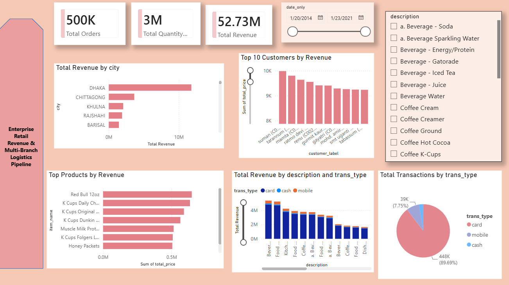

# Enterprise Retail Revenue & Multi-Branch Logistics Pipeline

An end-to-end analytics project on a retail **star schema** (1 fact table + 5 dimension tables, ~500K transactions). Raw CSVs are loaded into **SQL Server** with a validated ETL process, cleaned with **T-SQL views**, analyzed with SQL, and presented in an interactive **Power BI** dashboard with **dynamic row-level security** by city.



## Project Overview

The goal is to answer core business questions for a multi-branch retailer:

- Which cities, stores and products drive the most revenue?
- Who are the highest-spending and most frequent customers?
- How do sales change over time (month, year, trend)?
- Which payment methods do customers prefer?
- How can each regional manager see only their own city's data?

## Tech Stack

| Layer | Tools |
|---|---|
| Database | Microsoft SQL Server Express (T-SQL) |
| ETL | `BULK INSERT`, staging tables, `TRY_CAST` |
| Data cleaning | SQL views (`CROSS APPLY`, `PATINDEX`, `TRY_CONVERT`) |
| Analysis | Joins, aggregations, star-schema queries |
| Visualization | Power BI (Power Query, DAX) |
| Security | Dynamic row-level security (`USERPRINCIPALNAME()`) |

## Data Model

Star schema with one fact table and five dimensions:

```
customer_dim ─┐
item_dim ─────┤
store_dim ────┼──── fact_table (quantity, unit_price, total_price)
time_dim ─────┤
payment_dim ──┘

user_city_map  (standalone table used only by the security role, no relationships)
```

| Table | Key columns |
|---|---|
| `fact_table` | payment_key, customer_key, time_key, item_key, store_key, quantity, unit_price, total_price |
| `customer_dim` | customer key, name, contact_no, nid |
| `item_dim` | item_key, item_name, description (category), unit_price, man_country, supplier |
| `store_dim` | store_key, country, city, upazila |
| `time_dim` | time_key, date, hour, day, week, month, quarter, year |
| `payment_dim` | payment_key, trans_type (card / cash / mobile), bank_name |
| `user_city_map` | user_email, city (maps each user to the cities they may see) |

## ETL & Data Quality Steps

1. **Schema design:** created dimension and fact tables with primary keys and indexes on every foreign-key column of the fact table.
2. **Staging tables:** loaded `time_dim` and `fact_table` through temp staging tables so data types could be converted safely with `TRY_CAST`.
3. **Cleaning currency values:** stripped `$` and `,` characters from price columns before casting to `NUMERIC`.
4. **Quoted CSV handling:** reloaded `item_dim` with `FORMAT = 'CSV'` and `FIELDQUOTE = '"'` because product descriptions contain commas.
5. **Missing keys:** the first load left item keys in the fact table with no match in `item_dim`, so placeholder rows were inserted as a safeguard. The quote-aware reload of `item_dim` (step 4) then loaded the full item list, and the foreign key was added and validated against it.
6. **Referential integrity:** added foreign keys only after validation, and ran row-count and orphan-record checks (`03_verification.sql`).

## Data Quality Issues & How They Were Handled

Profiling the raw tables in SQL and Power Query showed several issues in `customer_dim` and `time_dim`. The raw tables are left untouched; cleaning happens in views (`sql/04_clean_views.sql`) that Power BI reads from.

| Issue | Where | Handling |
|---|---|---|
| NULL or blank names | `customer_dim.name` | Replaced with `Unknown Customer` |
| Stray double quotes | `customer_dim.name` | Removed with `REPLACE` |
| Address / relation text inside names (`s/o`, `d/o`, `w/o`, `r/o`, `c/o`) | `customer_dim.name` | Name cut off at the marker using `PATINDEX` |
| Alias markers (`name @ alias`, `name@alias`) | `customer_dim.name` | Name cut off at `@` |
| Non-numeric text in the phone column (rows shifted by commas in the source CSV) | `customer_dim.contact_no` | Valid only if 10 to 13 digits, otherwise NULL, with an `is_contact_valid` flag (17 rows flagged) |
| Date stored as text (`dd-mm-yyyy hh:mm`) | `time_dim.date` | Converted with `TRY_CONVERT(..., 105)` |
| Empty `week` column | `time_dim.week` | Derived with `DATEPART(ISO_WEEK, ...)` |

**Validation:** the views return the same row counts as the raw tables, and a check for dates that fail to parse is included in `04_clean_views.sql`. A few unusual name formats can still remain, since the cleaning handles the common patterns.

**Same-name customers:** many different customers share a name, so the SQL queries group by `customer_key`, and the dashboard's Top 10 Customers chart uses a `customer_label` column (name plus customer key) so people with the same name are not combined.

## Row-Level Security (Dynamic)

Each regional manager sees only the cities they are mapped to.

- The mapping table `user_city_map (user_email, city)` lives in SQL Server (`sql/05_rls_mapping.sql`) and is loaded into the model with no relationships.
- One role, `CityManager`, filters `store_dim`:

```dax
CONTAINS(
    user_city_map,
    user_city_map[user_email], USERPRINCIPALNAME(),
    user_city_map[city], store_dim[city]
)
```

- The filter flows `store_dim → fact_table`, so every visual (KPIs, products, payment split, customers) respects it.
- Changing access only means editing rows in `user_city_map`; the report is untouched.

**Tested with Modeling → View as:**

| View | Total Orders | Total Quantity | Total Revenue | Cities shown |
|---|---|---|---|---|
| No role (all data) | ~500K | ~3M | 52.73M | All |
| `dhaka.manager@company.com` | 112K | 672K | 11.80M | Dhaka only |
| `regional.head@company.com` | 131K | 788K | 13.85M | Dhaka and Khulna |
| `nobody@example.com` (not in the mapping table) | blank | blank | blank | None |

Dhaka accounts for about 22% of total revenue.


> Row-level security is enforced in the Power BI Service. In Power BI Desktop it is simulated with "View as". The emails in `user_city_map` are sample values.

## Key Numbers (from the dashboard)

- **~500K** total orders
- **~3M** units sold
- **52.73M** total revenue
- Date range: **Jan 2014 to Jan 2021**
- **Dhaka** is the top city by revenue (11.80M), followed by Chittagong, Khulna, Rajshahi and Barisal
- **Card** is the most-used payment type (~448K transactions, 89.7%), followed by mobile (~39K, 7.8%) and cash

## Dashboard Features

- KPI cards: total orders, total quantity, total revenue
- Date range slider and product-category filter
- Revenue by city, top 10 customers, top products
- Revenue by category split by payment type
- Transactions by payment type
- Dynamic row-level security by city

## Repository Structure

```
├── README.md
├── .gitignore
├── powerbi/
│   ├── dashboard.png              # dashboard screenshot
│   ├── rls_dhaka.png              # security test screenshot
│   ├── rls_multi_city.png         # security test screenshot
│   ├── rls_unlisted.png           # security test screenshot
│   └── Ecomm_sales_dashboard.pbix # Power BI file
├── data/                          # CSVs not included (see Dataset)
└── sql/
    ├── 01_schema_ddl.sql          # tables, keys, indexes
    ├── 02_load_data.sql           # ETL / bulk load
    ├── 03_verification.sql        # row counts, orphan checks, item_dim reload
    ├── 04_clean_views.sql         # cleaning views for customers and time
    ├── 05_rls_mapping.sql         # user_city_map table for dynamic RLS
    └── 06_queries.sql             # business analysis queries (uses the clean views)
```

## How to Run

1. Download the dataset (see below) and place the CSVs in `data/`.
2. Create a database: `CREATE DATABASE ecommerce_db;`
3. Update the file paths in `sql/02_load_data.sql` and `sql/03_verification.sql`.
4. Run the scripts in order: `01` → `02` → `03` → `04` → `05` → `06`. The queries in `06` use the views created in `04`, so keep this order.
5. Open `powerbi/Ecomm_sales_dashboard.pbix` in Power BI Desktop and point the data source to your `ecommerce_db` (Transform data → Data source settings). The `customer_dim` and `time_dim` queries read from `vw_customer_dim_clean` and `vw_time_dim_clean`.
6. To test security, go to Modeling → View as → Other user, enter an email from `user_city_map`, and tick the `CityManager` role.

## Dataset

Source: **"ECommerce Data Analysis"** dataset on Kaggle (6 tables: 1 fact, 5 dimensions).
Link: <https://www.kaggle.com/datasets/mmohaiminulislam/ecommerce-data-analysis>

The dataset is publicly available and credited to its original author. The SQL scripts, ETL process, cleaning views, security model and dashboard in this repo are my own work built on top of it.


## Author

**Harshita Jawaharmalani**
[LinkedIn](https://www.linkedin.com/in/harshita-jawaharmalani-2568b32aa) · [GitHub](https://github.com/harshitajawaharmalani)
